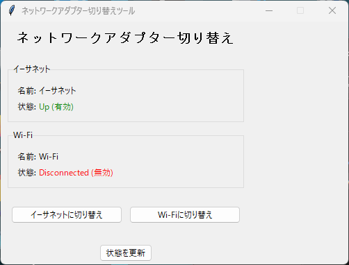

# ネットワークアダプター切り替えツール

[](https://github.com/roflsunriz/network-adaptor-switcher/actions/workflows/ci.yml)
[](https://github.com/roflsunriz/network-adaptor-switcher/actions/workflows/release.yml)
[](https://opensource.org/licenses/MIT)
[](https://www.python.org/downloads/)
[](https://www.microsoft.com/windows)

WindowsでイーサネットとWi-Fiアダプターを排他的に切り替えるGUIツールです。

## 概要

Windows PCにイーサネットとWi-Fiが接続されている場合、通常はイーサネットが優先されます。このツールでは、ボタン操作でイーサネットとWi-Fiを切り替えられます。

### 主な機能

- イーサネットアダプターとWi-Fiアダプターの自動検出
- ワンクリックでアダプターを排他的に切り替え
- アダプターの状態をリアルタイム表示
- 管理者権限チェック

## 必要な環境

- Windows 10/11
- Python 3.10以降
- 管理者権限（ネットワークアダプターの有効/無効化のため）

## 環境構築

### 1. リポジトリのクローンまたはダウンロード

```powershell
cd C:\Users\UserName\Documents
# または任意のディレクトリ
```

### 2. 仮想環境の作成

```powershell
python -m venv venv
```

### 3. 仮想環境の有効化

```powershell
.\venv\Scripts\Activate.ps1
```

PowerShellの実行ポリシーでエラーが出る場合：

```powershell
Set-ExecutionPolicy -ExecutionPolicy RemoteSigned -Scope CurrentUser
```

### 4. 依存パッケージのインストール

```powershell
pip install -r requirements.txt
```

## 使用方法

### アプリケーションの起動

**重要**: 管理者権限で実行する必要があります。

#### 方法1: PowerShellから管理者として実行

```powershell
# PowerShellを管理者として起動してから
cd C:\Users\UserName\Documents\network-adaptor-switcher
.\venv\Scripts\Activate.ps1
python src/main.py
```

#### 方法2: ショートカットを作成（推奨）

1. `src/main.py` を右クリック → 「ショートカットの作成」
2. ショートカットを右クリック → 「プロパティ」
3. 「ショートカット」タブ → 「詳細設定」→ 「管理者として実行」にチェック
4. 「リンク先」を以下のように編集：
   ```
   C:\Users\UserName\Documents\network-adaptor-switcher\venv\Scripts\pythonw.exe "C:\Users\UserName\Documents\network-adaptor-switcher\src\main.py"
   ```
5. 「作業フォルダー」を設定：
   ```
   C:\Users\UserName\Documents\network-adaptor-switcher
   ```

### 操作方法

1. アプリケーションを起動すると、現在のアダプター状態が表示されます
2. 「イーサネットに切り替え」ボタン：Wi-Fiを無効化してイーサネットを有効化
3. 「Wi-Fiに切り替え」ボタン：イーサネットを無効化してWi-Fiを有効化
4. 「状態を更新」ボタン：アダプター情報を最新の状態に更新

## 実行ファイル（EXE）のビルド

具体的な手順・構成・知見は [findings.md](<findings.md#readme-5>) に移動しました。着手前に該当条件を確認してください。

### クイックビルド

本文は [findings.md](<findings.md#readme-5>) を参照してください。


## 開発者向け

具体的な手順・構成・知見は [findings.md](<findings.md#readme-6>) に移動しました。着手前に該当条件を確認してください。

### コード品質チェック

本文は [findings.md](<findings.md#readme-6>) を参照してください。

#### 型チェック

本文は [findings.md](<findings.md#readme-6>) を参照してください。

#### リンターチェック

本文は [findings.md](<findings.md#readme-6>) を参照してください。

#### フォーマットチェック

本文は [findings.md](<findings.md#readme-6>) を参照してください。

#### 自動フォーマット

本文は [findings.md](<findings.md#readme-6>) を参照してください。

### テスト実行

本文は [findings.md](<findings.md#readme-6>) を参照してください。

### プロジェクト構造

本文は [findings.md](<findings.md#readme-6>) を参照してください。


## トラブルシューティング

### 管理者権限エラー

**エラー**: 「このアプリケーションは管理者権限で実行する必要があります」

**解決策**: PowerShellまたはアプリケーションを管理者として実行してください。

### アダプターが見つからない

**エラー**: 「イーサネットアダプターが見つかりません」または「Wi-Fiアダプターが見つかりません」

**解決策**:
1. デバイスマネージャーでアダプターが認識されているか確認
2. アダプターの名前やインターフェース説明を確認
3. 必要に応じて `src/network_manager.py` の `_parse_adapter_type` メソッドを調整

### PowerShellコマンド実行エラー

**エラー**: 「PowerShellコマンド実行エラー」

**解決策**:
1. PowerShellが正しくインストールされているか確認
2. `Get-NetAdapter` コマンドが手動で実行できるか確認
3. 実行ポリシーを確認：`Get-ExecutionPolicy`

## ログファイル

アプリケーションの動作ログは `network_adapter_switcher.log` に保存されます。

## コントリビューション

貢献を歓迎します。詳細は [CONTRIBUTING.md](CONTRIBUTING.md) を参照してください。

### 開発者向け情報

- [コントリビューションガイド](CONTRIBUTING.md)
- [ビルドガイド](BUILD.md)
- [セキュリティポリシー](SECURITY.md)
- [変更履歴](CHANGELOG.md)

### バグ報告・機能要望

- [Issue報告](https://github.com/roflsunriz/network-adaptor-switcher/issues)
- [Discussions](https://github.com/roflsunriz/network-adaptor-switcher/discussions)

## CI/CD

具体的な手順・構成・知見は [findings.md](<findings.md#readme-10>) に移動しました。着手前に該当条件を確認してください。

### 自動テスト

本文は [findings.md](<findings.md#readme-10>) を参照してください。

### 自動リリース

本文は [findings.md](<findings.md#readme-10>) を参照してください。


## ライセンス

MIT License

## 作成者

- 作成日：2026年2月14日
- バージョン：1.0.1

## 依存更新の自動処理

具体的な手順・構成・知見は [findings.md](<findings.md#readme-13>) に移動しました。着手前に該当条件を確認してください。
